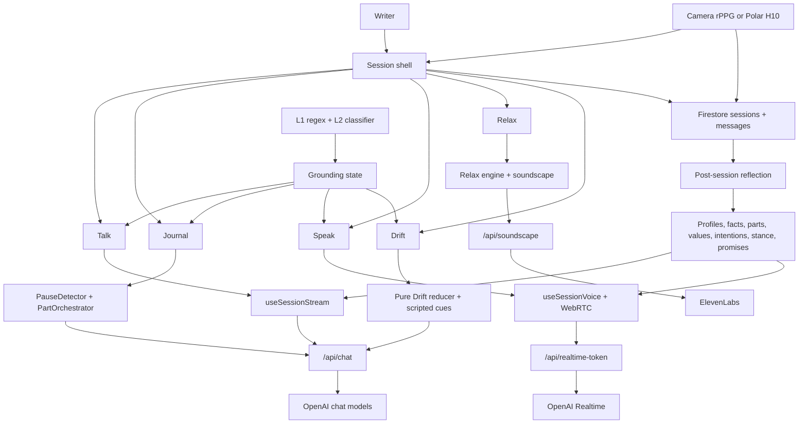

# UnderSurface App Review: Tree and Forest

**Date:** 2026-07-09
**Scope:** Current source at `aa2e7bc` (`main`), architecture, correctness, safety, privacy, data lifecycle, operations, product strategy, and market context.
**Method:** Read-only source review plus local verification, live smoke checks, dependency audit, comparison against the three earlier review artifacts, and current primary-source research. No application source was changed.

> **Remediation update (later on 2026-07-09):** the actionable safety, reliability, architecture, localization, product-copy, and release-engineering findings from this review were implemented after the snapshot described below. Privacy, security, and cost findings were deliberately excluded by scope. See `docs/superpowers/plans/2026-07-09-non-trust-remediation.md` for the exact completion matrix and verification record.

---

## Executive assessment

UnderSurface is now an unusually ambitious and thoughtfully engineered reflective-companion prototype. It has a coherent session shell, five meaningfully different surfaces, a sophisticated longitudinal companion model, unusually careful prompt and crisis-safety work, strong TypeScript discipline, and a very large test suite. The July remediation closed several severe failures: transcript deletion, conversation export, long-session request failure, cross-session stream bleed, voice grounding, camera-HRV overclaiming in prompts, per-user chat quotas, and several unbounded queries.

The product is **not yet ready for broad public growth or a paid launch**, however. The remaining blockers are concentrated at the trust boundary rather than in ordinary UI polish:

1. The privacy policy is materially inaccurate. All 17 translations still say OpenRouter, while the application uses OpenAI, OpenAI Realtime, ElevenLabs, Sentry, Firebase Analytics, and Google Ads. The policy also says data is not shared with anyone else, while several of those processors receive user-linked or potentially sensitive data.
2. “Export all data” is still a curated Markdown renderer, not a complete machine-readable export. Several collections are loaded and then never rendered; API-key metadata and diagnostics are omitted. Custom soundscape prompts and generated files live outside the user's deletable tree and survive account deletion.
3. The end-to-end crisis stack contradicts its own precision contract. The L2 prompt and eval correctly classify mundane “I want to die” hyperbole as risk 0, but the context-free L1 regex fires first and activates full grounding on the same phrase.
4. Cost controls cover only part of spend. The chat quota counts completion tokens but not input tokens; roles and total request size are not bounded; Realtime and soundscape limits remain per-instance; and there is no billing or entitlement layer.
5. The admin settings page still presents controls that the backend silently drops. The “Signal Update” action also cannot persist `buildVersion` even though the UI reports success.

The short version: **excellent product and safety thinking, strong prototype engineering, incomplete trust infrastructure**. This is suitable for a small adult alpha after the privacy/logging issues are contained. It should not be marketed as private, complete-export, therapy-adjacent, or production-scale until the P0 items below are closed.

### Scorecard

| Area | Assessment | Why |
|---|---|---|
| Core experience | **A-** | Talk, Journal, Speak, Relax, and Drift form a genuinely coherent reflective session rather than a bag of unrelated tools. |
| Differentiation | **A-** | Parts, Real Talk, consentful longitudinal memory, and Drift are distinctive in combination. Individual elements now have strong competitors. |
| Code quality | **B+** | Strict TypeScript, good pure engines, careful failure handling, and 1,499 passing offline tests across frontend/functions. Central files are still too large. |
| Safety architecture | **B** | Layered crisis handling, grounding invariants, voice propagation, and strong prompt tests. Full-stack precision and live evaluation remain incomplete. |
| Privacy and policy | **D** | Provider disclosure, analytics consent, observability scrubbing, processor inventory, and retention claims do not match the implementation. |
| Data lifecycle | **C** | Account deletion is much better and transcripts export, but export is not complete and top-level soundscape data is orphaned from the user lifecycle. |
| Security | **B-** | Strong Firebase-token boundaries and scoped MCP keys; weak schema rules, broad single-email admin authority, and untriaged dependency advisories remain. |
| Cost readiness | **C-** | Optional durable chat quota is a good start; prompt, voice, soundscape, and free-product economics are not controlled end to end. |
| Operational readiness | **B-** | CI and smoke tests are real, but live-model evals are opt-in, dependency audit is red, and builds have an external Sentry side effect. |
| Public-launch readiness | **No-go today** | Trust claims and user data rights must match reality first. |

---

## What the product actually is

The app has completed its pivot from “a diary where inner voices respond” to a **session-first reflective companion**. A session is the durable unit. The user moves among:

- **Talk:** streamed GPT-5.5 conversation with standard and Real Talk tones.
- **Journal:** private TipTap writing with optional pause-triggered inner-part responses.
- **Speak:** direct browser-to-OpenAI Realtime voice.
- **Relax:** scripted breath/body/open-awareness sessions with audio and optional voice guidance.
- **Drift:** a short bilateral noticing-and-settling practice with deterministic progression and optional sparse companion turns.

The product also has a second layer that most users will not see unless flags are enabled: mapped user parts, coined language, session intentions, stance adaptation, values, companion promises, carried observations, rupture repair, rumination pivots, presence, earned humor, and story arcs.

That is the real product thesis: **the companion becomes more particular without pretending to become a clinician**. The best work in the repo supports that thesis. The biggest strategic danger is letting the feature count obscure it.

### System map



This is a sensible high-level architecture. The risk is not the diagram; it is that many arrows converge in `SessionView.tsx`, `useSessionStream.ts`, `therapistPrompts.ts`, and client-side Firestore orchestration.

---

## Change since the July 3 reviews

The codebase changed dramatically in six days: **116 commits, 175 files changed, 17,853 insertions, and 939 deletions** from the first remediation commit through current HEAD. That speed produced real value, but it also means prior “all fixed” language must be re-verified against current source.

### Confirmed improvements

- Long sessions now window raw history to 48 messages (`src/ai/therapistPrompts.ts:699-744`).
- Account deletion is tombstone-first, deletes nested session messages before parents, includes API keys, removes contact messages and quotas, and tolerates retries (`functions/src/account.ts:37-77`).
- Markdown export now includes session transcripts and notes (`src/store/dataExport.ts:266-288`).
- Admin authentication now requires a verified email (`functions/src/shared/auth.ts:30-42`).
- Text sessions now have a standalone L2 crisis backstop in addition to the in-band preamble; live voice receives grounded instructions.
- Cross-session stream bleed, dropped-message interleaving, duplicate sends, voice-connect cancellation, and several retry/timeout errors received targeted regression coverage.
- Camera-derived HRV metrics no longer reach the companion as precise facts; camera context is hedged to approximate HR/trend (`src/engine/hrvTimeline.ts:35-55`).
- Chat aborts upstream work on disconnect and reports truncated streams as errors (`functions/src/chat.ts:271-309`, `:340-384`).
- The app now has an optional Firestore-backed monthly completion-token quota.
- Session lists use a bounded live subscription; multiple memory reads are bounded; old memory growth is pruned.
- Modal focus handling, reduced-motion support, and user-facing voice errors improved.
- Drift v2 is substantially better than its first design: it is time-boxed, tap-first, deterministic when the writer does not type, and structurally prevents intentional return to activating material.

### Earlier findings that remain open or only partly fixed

| Earlier finding | Current status |
|---|---|
| Wrong provider in privacy policy | **Still open in all 17 locales.** |
| Export omits conversations | **Conversation transcripts fixed; full-data claim still false.** |
| Delete leaves nested messages/API keys | **Fixed for the user tree; top-level soundscape data is newly outside that lifecycle.** |
| Admin config allowlist mismatch | **Still open.** The UI/backend schemas still disagree. |
| Per-instance rate limiting | **Partly mitigated for chat completion tokens only.** Realtime, soundscape, MCP, and contact remain incomplete. |
| Schema-free owner wildcard | **Still open.** |
| Broad admin access/no audit | **Email verification fixed; single-account authority and no read audit remain.** |
| Crisis precision/clinical-grade validation | **Architecture improved; full-stack false-positive contradiction remains.** |
| “Therapist” user-facing wording | **Mostly fixed in UI; product/docs/prompt vocabulary and experience still sit close to therapy.** |
| Bundle splitting warnings | **Still open; engines chunk is now 681 kB minified.** |
| Stale documentation | **README/CLAUDE were refreshed, then immediately drifted: both say four surfaces and omit Drift in their opening description.** |
| `SessionView` overload | **Still open and larger: 1,018 lines.** |
| Unbounded HRV document | **Still open.** |

---

## Material findings

Severity means priority for this product, not a universal CVSS-style score:

- **P0:** close before public growth, paid launch, or strong privacy/safety claims.
- **P1:** next engineering cycle.
- **P2:** important hardening or strategic debt.

### P0 — The privacy policy and consent record do not describe the product

The English policy says user text is sent to **OpenRouter**, that the provider does not permanently store content, and that UnderSurface does not sell or share data with anyone else (`src/i18n/translations/en.ts:289-297`). The same OpenRouter sentence exists in all 17 locales.

Current implementation instead uses:

- OpenAI Chat Completions for conversation, reflection, classification, and admin insights (`functions/src/chat.ts:287-309`; `functions/src/admin/handlers.ts:389-405`).
- OpenAI Realtime for live voice, with a client secret and direct browser connection (`functions/src/realtime.ts:75-103`; `src/hooks/useVoiceSession.ts:253-263`).
- ElevenLabs for custom soundscape prompts (`functions/src/soundscapeApi.ts:63-67`).
- Sentry for errors, performance sampling, user ID/email association, and potentially console breadcrumbs (`src/main.tsx:30-60`; `src/auth/AuthContext.tsx:48-57`).
- Firebase Analytics with an authenticated user ID and session identifiers (`src/services/analytics.ts:25-56`; `src/auth/AuthContext.tsx:48-55`).
- Google Ads conversion tracking loaded before authentication or consent (`index.html:31-38`).

The policy does not identify these processors, distinguish controller/processor roles, disclose analytics/advertising, state retention periods, explain cross-border processing, or give a policy effective date/contact. Consent is stored as a hardcoded `acceptedVersion: '1.0'` (`src/components/Onboarding.tsx:78-88`), so a materially rewritten policy cannot trigger re-consent without a code change.

OpenAI's current API documentation says API inputs/outputs are not used for model training by default, but abuse-monitoring logs may contain prompts and responses and are generally retained for up to 30 days unless a different control applies. That is a much more accurate disclosure than “does not permanently store.” See [OpenAI data controls](https://platform.openai.com/docs/models/default-usage-policies-by-endpoint) and [OpenAI business-data privacy](https://openai.com/business-data/).

This is not a cosmetic legal-text problem. The app asks people to disclose mental-health-adjacent material, relationship details, names, dates, biometric measurements, and crisis language. The privacy promise is part of the product.

**Recommendation:** create a versioned processor/data-flow inventory first, then rewrite every locale from that inventory. Separate required processing (Firebase/OpenAI) from optional processing (analytics/ads/Sentry), state retention and deletion behavior accurately, and require new consent for a material version change. Do not activate analytics or Ads before the applicable consent decision.

### P0 — Sensitive reflection output can reach Sentry through console breadcrumbs

`sessionReflectionEngine` logs the first and last 120 characters of the model's reflection response and logs counts and write decisions (`src/engine/sessionReflectionEngine.ts:96-123`, `:218-231`). Those response fragments can contain names, relationships, locations, dates, threads, emotional patterns, or other extracted details. The test output demonstrated this directly with names and locations.

The browser Sentry SDK automatically records console API calls as breadcrumbs unless configured otherwise. UnderSurface's `beforeSend` filters a few exception messages but does not scrub breadcrumbs, URLs, user context, or console data (`src/main.tsx:37-59`). The app also sets Sentry user email (`src/auth/AuthContext.tsx:51-54`). See [Sentry's breadcrumb documentation](https://docs.sentry.io/platforms/javascript/guides/svelte/enriching-events/breadcrumbs/).

An unrelated exception after reflection can therefore attach private model-output fragments to a Sentry event. This also conflicts with the policy's “do not share” language.

**Recommendation:** remove all content-bearing production console logs; use first-party diagnostic codes and numeric metadata only. Add `beforeBreadcrumb` and stronger `beforeSend` scrubbing, remove email from `Sentry.setUser`, turn off default PII, and explicitly test an event payload containing a mock reflection for absence of content.

### P0 — “Export all data” is not a complete export, and soundscape data survives deletion

`exportAllData` loads 23 user collections and every session transcript, then passes them through a hand-written Markdown renderer (`src/store/dataExport.ts:307-340`). The renderer has no sections for several loaded collections, including:

- `hrvSessions`
- `relaxSessions`
- `driftSessions`
- `companionSignals`
- `userParts`
- `sessionIntentions`
- `stanceProfile`
- `userValues`
- `companionPromises`
- much of `innerWeather` and other raw metadata

`apiKeys` and `diagnostics` are not loaded at all. There is no JSON export. The current tests cover only transcripts, personal facts, and consent (`src/store/dataExport.test.ts:16-68`), so they prove the earlier regression was fixed but not the “all data” claim.

The custom soundscape path creates a second lifecycle gap. A user-entered prompt is stored verbatim in top-level `soundscapes/{hash}` along with the generated Storage object (`functions/src/soundscape/cache.ts:63-72`, `:120-174`). It has no `uid`, TTL, export path, or deletion path. `handleDeleteAccount` deletes the user tree, contact messages, and quota only (`functions/src/account.ts:52-68`). The top-level prompt and audio therefore survive account deletion and cannot be attributed back to the deleting user.

This makes the policy statement “stored for as long as your account exists” false for custom soundscape prompts.

**Recommendation:**

1. Produce a ZIP with `data.json` as the canonical complete export and a human-readable Markdown companion.
2. Define one shared lifecycle schema with collection/path, ownership, sensitivity, exporter, deletion rule, retention, and writer authority.
3. Store soundscape cache entries without the raw prompt after generation, or attach an ownership/reference model with retention and deletion semantics. Add a Storage/sidecar TTL.
4. Add a contract test that seeds every registered data type, exports it, deletes the account, and asserts no user-attributable residue.

### P0 — The full crisis stack violates its precision contract

The L2 classifier prompt and eval correctly say mundane hyperbole such as “I want to die, this dentist appointment is taking forever” must be risk 0 (`src/ai/crisisClassifierPrompt.ts:97-105`; `src/engine/crisisClassifier.eval.ts:88-92`). The in-band therapist preamble has the same instruction (`src/ai/therapistPrompts.ts:41-70`).

But L1 runs synchronously first and contains `/want\s+to\s+die/`, `/kms/`, `/overdose/`, `/can't\s+do\s+this\s+anymore/`, and similar context-free patterns (`src/engine/sessionOrchestrator.ts:8-49`). A literal match activates full grounding before L2 can classify context (`:94-103`). Unit tests explicitly require the exact phrase “I can't do this anymore” to fire (`src/engine/sessionOrchestrator.test.ts:265-270`).

So the carefully calibrated L2 eval does not represent actual product behavior. The app still over-calls the exact hyperbole the eval says must not be flagged. This is particularly visible in a journaling product, where dramatic or figurative language is common.

The architecture is otherwise good: explicit-method and plan phrases are appropriate deterministic floors; L2 adds multilingual/contextual coverage; risk 2 can abort and retry grounded; voice receives grounding; Drift converges toward closure. The missing artifact is a **full-stack eval** that runs L1 then L2 and scores the user-visible outcome.

**Recommendation:** split L1 into:

- an unconditional hard floor for explicit method/plan/first-person self-harm constructs; and
- context-requiring phrases that defer to L2 or use a narrow deterministic disambiguator.

Then run the existing multilingual cases through the entire decision pipeline, not the classifier in isolation. Record false-positive rate, false-negative rate, latency to grounding, and cross-channel parity. Do not change calibration without that end-to-end harness and clinical review.

---

### P1 — Cost controls do not bound total model spend

The durable quota is a good reserve/reconcile design, but it reserves and reconciles **completion tokens only** (`functions/src/chat.ts:235-269`). Input tokens are logged but not charged to the quota (`:394-397`). This matters because GPT-5.5 input is currently $5/M tokens and output $30/M tokens, while GPT-Realtime-2 audio is $32/M input and $64/M output ([GPT-5.5 pricing](https://developers.openai.com/api/docs/models/gpt-5.5), [GPT-Realtime-2 pricing](https://developers.openai.com/api/docs/models/gpt-realtime-2)).

The chat request validator also:

- accepts any role string;
- caps content length only when `role === 'user'`;
- lets an authenticated caller label large payloads as `system` or `assistant`;
- accepts client-selected reasoning up to `xhigh`; and
- exempts classifier tasks from the durable quota (`functions/src/chat.ts:190-249`).

Realtime uses a per-instance 10/min limiter and grants a directly usable 10-minute client credential (`functions/src/realtime.ts:32-33`, `:56-59`, `:102-118`). Soundscape generation uses per-instance 5/hour and 60/hour maps (`functions/src/soundscape/limits.ts:1-19`). The shared limiter explicitly says it is not shared across instances (`functions/src/shared/rateLimit.ts:1-23`). Contact submission has no limiter.

There is also no subscription, entitlement, or billing code in the repo. With warm chat and Realtime functions plus frontier models, free public usage has no sustainable unit-economics boundary.

**Recommendation:** validate exact roles and per-task message shapes, cap total request bytes, control reasoning server-side, count prompt + completion tokens, add durable voice-minute/audio-token and soundscape-generation budgets, and require an explicit product entitlement. Keep crisis checks exempt but tightly shape their input.

### P1 — Admin settings still silently discard controls and fake “Signal Update” success

The admin UI edits `defaultResponseSpeed`, `atmosphere`, `partIntelligence`, `engagement`, `grounding`, `voice`, and `features` (`src/admin/AdminSettings.tsx:5-89`, `:110-115`). The backend allowlist accepts only:

```text
features, tuning, grounding, announcement, quota
```

(`functions/src/admin/handlers.ts:321-348`). There is no `tuning` field in `GlobalConfig`; the actual sections are `atmosphere`, `partIntelligence`, `engagement`, and `voice` (`src/admin/adminTypes.ts:76-120`). `defaultResponseSpeed` is also excluded.

`signalUpdate` sends a new `buildVersion` and always shows success if the request resolves (`src/admin/useAdminConfig.ts:54-69`), but `buildVersion` is not in the backend allowlist. The change is stripped, so users never receive the refresh signal.

Tests miss the integration bug because frontend tests mock the server echo and backend tests validate the obsolete `tuning` key rather than the shared `GlobalConfig` contract.

**Recommendation:** make a single server-owned schema the source of truth, reject unknown fields with a 400 instead of silently dropping them, and add an integration test that changes every rendered control and reads it back from Firestore. Treat `buildVersion` as an explicit action or allowed audit field.

### P1 — Camera/Polar archive documents still grow without a bound

`HrvTimeline.events` and `shifts` grow for the entire session (`src/engine/hrvTimeline.ts:6-22`). Every 10 seconds, `useHrvSession` rewrites one Firestore document with all measurements, all shifts, and the last 10 signal dumps (`src/hooks/useHrvSession.ts:27-71`, `:105-108`). This remains O(n²) upload over time and will eventually hit Firestore's 1 MiB document limit. Errors are only sent to `console.error`.

The July remediation correctly stopped camera HRV-derived precision from reaching the companion, but it did not fix archival shape. The consent prose also says “only derived metrics” are saved while the archive includes raw-ish RGB/CHROM/FFT diagnostic buffers, albeit not video (`src/hooks/useHrvSession.ts:45-61`; `src/components/Session/HrvConsentDialog.tsx:80-82`).

**Recommendation:** store a bounded summary document plus time-bucketed/chunked samples with TTL. Make raw diagnostic capture opt-in, short-lived, and separately disclosed. Surface persistence failures in first-party diagnostics.

### P1 — Dependency audit is red and includes deployed transitive packages

Current read-only audits reported:

- Root: 7 advisories, including a critical `protobufjs` advisory and high advisories in `@grpc/grpc-js`, `minimatch`, and `picomatch`.
- Functions: 20 advisories, including high advisories in `@grpc/grpc-js`, `hono`, `fast-uri`, `fast-xml-builder`, `form-data`, and `protobufjs`.

Some are build tooling or code paths not reachable with attacker-controlled schemas, so the audit count is not the same as exploitable product risk. Others are in deployed Firebase/MCP dependency trees and need a real reachability decision. The repo has no audit or dependency-review gate in CI.

**Recommendation:** triage each runtime advisory, upgrade non-breaking paths immediately, test the Firebase Admin major upgrade required for the remaining `uuid` chain, and add a documented allowlist with expiry for anything consciously deferred. Do not leave a critical result as ambient noise.

### P1 — Firestore rules preserve isolation but not integrity

The rule `match /users/{userId}/{document=**}` allows the authenticated owner to read and write every document under their user tree (`firestore.rules:4-6`). This blocks cross-user access, which is the most important boundary, but it allows a modified client to forge consent records, summaries, memories, profiles, diagnostics, session metadata, feature-learning state, and API-key metadata.

Because the reflection engine currently runs client-side, simply making those collections server-write-only would break the app. The deeper issue is that trusted derived state and user-authored state share one authority domain.

**Recommendation:** define per-collection schemas and writer authority. Move high-trust derived writes behind a server boundary or use signed/validated callable actions. At minimum, enforce field sets, types, size caps, immutable ownership/timestamps, and status-transition rules.

### P1 — Admin access is too broad for the sensitivity and has no read audit

Backend authorization is correctly enforced and now checks `email_verified`. However, one hardcoded email has raw cross-user access to entries, conversations, memories, profiles, contact messages, and diagnostics (`functions/src/shared/auth.ts:3`, `:30-42`; `functions/src/admin/index.ts:38-88`). There is no admin read audit, reason code, role separation, step-up authentication, or privacy-preserving support view.

Admin insights also concatenate user-writable summaries/profiles from all users into one untrusted model prompt without content wrapping (`functions/src/admin/handlers.ts:351-405`). A crafted stored value can manipulate the aggregate output or cause other users' sensitive themes to be reproduced. The read is unbounded across users and summaries.

**Recommendation:** Firebase custom claims or a proper role store, enforced MFA/step-up for admin, append-only read audit logs, least-privilege views, explicit “view sensitive content” actions, bounded analytics inputs, and prompt isolation for stored user content.

### P1 — Soundscape generation claims can still duplicate expensive work

The transactional claim is a strong improvement, but a losing request polls for about 20 seconds and then falls through to generation even if the winner's 30-second claim is still fresh (`functions/src/soundscape/cache.ts:135-151`). The provider can take 25 seconds per attempt and retry once (`functions/src/soundscape/provider.ts:11-13`, `:55-87`). Therefore a slow but healthy winner can still be duplicated by every waiter after 20 seconds.

The pure claim tests cover “should claim” decisions but not the poll-timeout flow (`functions/src/soundscape/cache.claim.test.ts:1-40`).

**Recommendation:** after polling, re-enter the transaction and generate only if the claim is actually stale and successfully re-acquired. Add a fake-timer concurrency test with a 24-second provider response.

### P1 — High-stakes live evals are opt-in and absent from the normal release gate

The default suite skipped 17 tests across crisis, signals, parts, intentions, stance, companion depth, and Drift. These are the tests that exercise actual model behavior. CI runs unit tests, lint, types, Firestore emulator tests, and build, but none of the live eval scripts (`.github/workflows/ci.yml:42-69`).

For ordinary feature code, deterministic tests are the right default. For a companion that depends on prompt calibration, an offline suite proves structure and parsing, not behavioral quality.

**Recommendation:** run a budgeted, pinned live eval before releases and on a schedule; archive model snapshot, prompt hash, per-category results, latency, and cost. Keep PR CI deterministic, but make the production release gate consume the latest passing eval artifact.

### P1 — No age policy or gate exists for a direct emotional companion

The app offers email signup and social login without an age declaration, youth-specific policy, or parental flow. This matters because the FTC's current companion-chatbot inquiry explicitly asks about safeguards, disclosures, monetization, data use, and negative effects for children and teens ([FTC companion-chatbot inquiry](https://www.ftc.gov/news-events/news/press-releases/2025/09/ftc-launches-inquiry-ai-chatbots-acting-companions)).

**Recommendation:** choose the intended audience deliberately. The lowest-risk path is an adult-only beta with an explicit 18+ gate and product copy that does not imply treatment. If minors are in scope, that becomes a separate safety, consent, privacy, and clinical-governance program.

---

### P2 — The architecture is accumulating faster than it is consolidating

The repository contains roughly **39,066 production TypeScript lines** and **20,557 test/eval TypeScript lines**. The largest coordination files are:

- `src/engine/hrvSignalWorker.ts` — 1,368 lines
- `src/ai/therapistPrompts.ts` — 1,123 lines
- `src/components/Session/SessionView.tsx` — 1,018 lines
- `src/engine/polarH10Engine.ts` — 968 lines
- `src/admin/AdminSettings.tsx` — 946 lines
- `src/engine/sessionReflectionEngine.ts` — 709 lines
- `src/hooks/useSessionStream.ts` — 689 lines

The July runtime fixes improved behavior, but the planned `sessionRuntime.ts` kernel and real SessionView decomposition do not exist. The most complex state still spans React state, refs, global stores, Firestore subscriptions, timers, abort controllers, WebRTC events, and post-session fire-and-forget jobs.

**Recommendation:** stop adding companion features until the session runtime, lifecycle fencing, and persistence authority are explicit modules. Decompose by ownership, not by visual component: session lifetime, message journal, surface state, biometrics, reflection jobs, and companion-context assembly.

### P2 — The feature portfolio is strategically overextended

There are 25 user subcollections and roughly 33 experimental flags, nearly all default off. This is good risk containment, but it also means the code carries a broad speculative portfolio: body maps, letters, echoes, rituals, unfinished threads, two biometric sources, custom sound generation, multi-layer companion memory, five surfaces, admin analytics, MCP, PWA, and two native shells.

The strongest loop is much smaller:

```text
arrive in Talk → write privately or settle in Drift → close → reflection updates user-owned memory → next session recalls one useful thread
```

Everything that does not strengthen that loop is competing for reliability, evaluation budget, and user understanding.

**Recommendation:** choose three public pillars and keep the rest as experiments. My choice would be **Talk, Journal, Drift**, with Speak as a paid extension and Relax as a small set of deterministic practices. Biometrics and generated soundscapes should remain labs until the core loop has retention evidence.

### P2 — Product copy describes three different products

- Source behavior is session-first and now has five surfaces.
- README and CLAUDE open by saying four surfaces, omitting Drift (`README.md:3-14`; `CLAUDE.md:5`).
- Onboarding, landing copy, app subtitle, HTML metadata, and PWA manifest still promise a diary where inner voices respond (`src/i18n/translations/en.ts:21-31`, `:270`, `:353`; `index.html:8-23`; `public/manifest.json:2-5`).
- The default post-onboarding route opens a Talk session, not the promised diary experience (`src/App.tsx:269-276`; `src/components/Session/SessionView.tsx:96-110`).

That mismatch harms activation: someone who wants a journal meets a chatbot; someone who wants a companion is marketed a diary.

**Recommendation:** make the landing/onboarding demonstrate the actual first 60 seconds. Pick one headline and one first action. “A private reflection session that remembers what matters” is closer to the current product than either “AI therapist” or “diary with voices.”

### P2 — Localization quality stops at key parity

Key parity across 17 locales is a real strength. But both biometric consent dialogs contain English-only legal/health prose (`src/components/Session/HrvConsentDialog.tsx:60-162`; `PolarH10ConsentDialog.tsx:66-169`). Settings and several error paths still have hardcoded English. All 17 policy translations repeat the same stale provider claim.

**Recommendation:** distinguish “key parity” from “experience parity.” Add a test that flags user-visible string literals in public components, and require native review for policy, crisis, consent, and safety strings.

### P2 — Build and bundle operations need cleanup

The production build passed but emitted five static/dynamic import conflicts and a 681 kB minified `engines` chunk (218 kB gzip). The Workbox precache is roughly 2.5 MiB. On a mobile-first reflective app, editor/engine startup and service-worker update behavior deserve measurement.

The build also uploaded source maps to Sentry because `.env.local` contained a Sentry token (`vite.config.ts:7-11`, `:47-52`). A local verification build is therefore not read-only with respect to external services.

**Recommendation:** make source-map upload an explicit release command, not an implicit side effect of any production-mode build. Use route/surface boundaries for code splitting, and record cold-load/Web Vitals on representative mobile hardware.

### P2 — Several bounded-read and retention edges remain

Examples:

- Story-arc generation reads every entry summary and slices afterward (`src/engine/storyArc.ts:41-55`).
- Session message subscriptions and export read whole message collections (`src/store/db.ts:177-189`).
- Admin insights read all summaries for all users before creating one 800-token response (`functions/src/admin/handlers.ts:351-405`).
- Contact messages are retained without a policy or deletion UI except account deletion.
- Soundscape cache/storage has no TTL.

These are not immediate alpha blockers, but they will become cost and privacy problems at scale.

---

## Tree review: subsystem-by-subsystem

### Session runtime and UI

**What is strong**

- The session-first route is simple and understandable.
- Root redirects now use `replaceState`, preventing the old blank-back-page failure (`src/App.tsx:161-174`).
- Session history windowing and message-append serialization address the worst earlier correctness failures.
- Surface availability is flag-gated, and grounding appropriately suppresses Drift and parts.
- Session tone is one pipeline with a clear Real Talk override, not a forked product.

**What needs work**

- `SessionView` still owns session creation/loading, five surfaces, editor state, sending, closing, notes, reflection, biometrics, recommendation routing, overlays, and layout.
- `getGlobalConfig()` is read repeatedly during render and callbacks instead of flowing through a stable feature-capability object.
- Several background jobs are best-effort and console-only on failure. The product has no visible “reflection pending/failed” semantics.
- Tests are broad, but three component/hook test files assert source text, which protects implementation strings rather than behavior.

### AI transport and prompting

**What is strong**

- The server pins models and secrets; the client cannot choose a different paid model.
- Streaming SSE parsing handles malformed preambles, empty completions, idle timeout, abort, and truncation.
- Stored user content is commonly wrapped as untrusted content before prompt insertion.
- Memory context is token-budgeted rather than fixed-count.
- Prompt blocks have explicit non-stacking and grounding suppression rules.

**What needs work**

- `therapistPrompts.ts` is becoming a policy engine, content renderer, memory composer, classifier prompt, and reflection schema in one file.
- The number of prompt blocks creates interaction risk that pairwise tests do not fully cover.
- Admin insights do not use the same untrusted-content wrapper discipline.
- Model aliases are rolling rather than snapshot-pinned. That is useful during active development, but release evaluation should bind a model snapshot or at least record alias resolution.

### Crisis safety

**What is strong**

- Defense in depth: deterministic floor, independent classifier, in-band context-aware signal, global grounding store.
- Crisis state reaches text, Journal, voice, and Drift.
- Real Talk, parts, proposals, humor, presence, and other companion behaviors are suppressed under grounding.
- The multilingual L2 corpus is unusually thoughtful and explicitly protects grief, metaphor, IFS language, and hyperbole.
- Drift has a monotonic settling invariant and fixed safety copy.

**What needs work**

- Full-stack precision conflict described above.
- Live evals are not part of a release artifact.
- L1 is English-only by design, making L2 availability/latency more important in other languages.
- The app has no human escalation, safety case, incident review procedure, or post-market monitoring rubric.
- “No hotline numbers in model output” is sensible for tone, but requires the deterministic crisis UI to be reliably visible and localized in every channel.

### Longitudinal memory and companion depth

**What is strong**

- The design respects consent better than typical AI-memory systems: user parts and values become active through explicit UI decisions.
- Caps, evidence trails, deduplication, retired-state stickiness, proposal scarcity, and grounding suppression are excellent design choices.
- Intentions distinguish volunteered commitments from aspirations, and absence is not treated as failure.
- Stance adaptation prefers “unclear” over guessing and treats tendencies as weak priors.

**What needs work**

- The reflection pass remains a single model response feeding many downstream stores. One malformed or subtly biased response can influence multiple future behaviors.
- Client-owned derived collections can be forged and do not carry provenance/model/prompt version.
- Users can manage parts and values, but there is no unified “what the companion remembers about me” screen covering facts, patterns, intentions, stance, promises, and carried observations.
- Deletion/export rights are fragmented by representation.

The strategic opportunity is to turn this machinery into a **user-owned memory ledger**: every remembered item visible, correctable, forgettable, sourced, and time-stamped. That would convert hidden complexity into a trust feature.

### Drift and Relax

**What is strong**

- Drift's pure reducer is the clearest runtime authority in the app.
- Tap-only check-ins are deterministic, fast, and avoid unnecessary model calls.
- The no-return invariant and stronger→settle routing are prudent.
- The product avoids clinical technique branding in UI/prompt copy and labels Drift as self-guided, not treatment.

**What needs work**

- Product behavior is still inspired by clinical/somatic practices. Avoiding a term does not eliminate the need for safety evidence and careful claims.
- Custom soundscape storage/retention and duplicate-generation flaws need resolution.
- Realtime passive mode still creates a metered bidirectional-compatible session using a synthetic silent track.
- Relax and Drift increase product breadth before the core companion loop has public retention data.

### Biometrics

**What is strong**

- Polar H10 parsing, RR handling, PMD accelerometer work, and pure math tests are unusually deep.
- Camera and Polar feed a shared measurement shape.
- The camera prompt path now openly hedges uncertainty and excludes derived HRV claims.
- Source mutex prevents simultaneous camera/strap sessions.

**What needs work**

- The camera feature still calls itself “HRV” and stores derived HRV metrics even though the prompt path rightly distrusts them.
- Raw diagnostic buffers, archive growth, consent text, and retention are not aligned.
- There is no validation evidence that webcam respiration/channel fusion improves outcomes.
- The feature increases regulatory/health-data surface while remaining default off and unproven as a retention driver.

Keep Polar as the credible advanced path. Treat webcam as experimental approximate pulse/breath context unless and until benchmarked against a reference device.

### Backend, auth, and MCP

**What is strong**

- Every normal API derives identity from a verified Firebase token.
- MCP keys use strong random material, store only a SHA-256 hash, and scope every tool to the resolved owner.
- MCP tools are read-only and offset/message reads are bounded.
- Secrets remain server-side; CORS is explicit for browser APIs.
- Account deletion is now correctly ordered and idempotent.

**What needs work**

- Per-instance limits do not provide a global security or cost boundary.
- MCP's dependency tree currently includes vulnerable Hono and related packages; reachability must be reviewed.
- The API relies on `req.body` without a visible app-level body-size policy.
- Admin authorization and auditing remain too coarse.
- Contact spam and retention are ungoverned.

### Testing and CI

**What is strong**

- 98 test/eval files and 20.5k test/eval lines are exceptional for a project of this size.
- Pure engines have strong edge-case coverage.
- Functions tests now run in CI.
- CI provisions Java 21 for Firestore emulator tests.
- Safety invariants such as Real Talk grounding override have direct regression tests.

**What needs work**

- Tests do not connect the admin UI config schema to the backend allowlist.
- Export tests do not enumerate the lifecycle registry.
- Crisis eval tests L2, not user-visible full-stack behavior.
- Soundscape claim tests omit the waiter timeout path.
- Live-model results are ephemeral console output rather than versioned release artifacts.
- No dependency audit/review gate exists.

---

## Forest review: market, trust, and strategy

### The market is validated and crowded

UnderSurface is not entering an empty “AI journal” category:

| Product/category | Current promise | Implication for UnderSurface |
|---|---|---|
| Apple Journal | On-device suggestions; iCloud entries can be end-to-end encrypted so Apple cannot read them ([Apple](https://www.apple.com/legal/privacy/data/en/journaling-suggestions/)). | Privacy expectations are set by a platform-scale default. |
| Day One | End-to-end encryption on by default for new journals; even Day One says it cannot read them ([Day One](https://dayoneapp.com/features/end-to-end-encryption/)). | “Encrypted in transit/at rest” is no longer a differentiator for intimate writing. |
| Rosebud | AI journal, voice, long-term memory, goals, weekly patterns, therapy/coaching bridge; claims 150k+ journalers and HIPAA-aligned practices ([Rosebud](https://www.rosebud.app/therapy-and-coaching)). | The between-session therapy/coaching position is already occupied by a better-capitalized product. |
| Mindsera | AI companion, voice, multi-perspective “Minds,” whole-journal pattern analysis, memory controls; claims 80k users and charges about $10.75–$14.99/month ([Mindsera](https://mindsera.com/)). | Multi-perspective AI journaling and longitudinal insight are now table stakes, not a moat alone. |
| Wysa | Safety-assured mental-health chatbot with a substantial clinical-evidence posture and an explicit crisis limitation ([Wysa](https://www.wysa.com/clinical-evidence)). | Competing on “AI mental health support” implies a much higher evidence and governance burden. |

UnderSurface's combination remains distinctive, but its individual ingredients do not:

- longitudinal memory: common;
- voice: common;
- journaling analysis: common;
- multiple AI perspectives: Mindsera already markets “Minds”;
- between-session support: Rosebud's explicit position;
- breathwork/somatic exercises: common in wellness apps;
- AI companion: crowded and increasingly scrutinized.

The defensible core is the **interaction grammar**:

1. the writer can talk, write, speak, or settle without starting a new product;
2. memory is particular and can become collaborative rather than invisible;
3. “parts” are used as a gentle user-controlled vocabulary, not imposed diagnosis;
4. the companion can change stance based on evidence while retaining safety invariants; and
5. Drift provides an embodied exit from verbal rumination without pretending to be treatment.

That is more interesting than “AI therapist” and more differentiated than “AI journal.”

### Trust is the market wedge, but the implementation currently trails the claim

Apple and Day One make “even we cannot read it” a core promise. Rosebud and Mindsera prominently state that data is not used for model training and describe privacy/security in marketing. UnderSurface currently gives administrators direct plaintext access, sends content to third-party models, links analytics to Firebase UIDs, and has no user-facing memory ledger.

It cannot win a privacy-first position through copy. It needs architecture:

- local/private writing mode where content never reaches a model;
- explicit per-action consent for deep AI reflection;
- user-visible memory and provenance;
- minimized observability;
- complete export/deletion;
- eventually, client-side encryption for stored content, with a clearly explained tradeoff when AI access is enabled.

The Office of the Privacy Commissioner of Canada advises that chatbot inputs may be collected, stored, used to create profiles, or disclosed, and emphasizes limiting sensitive personal information ([OPC guidance](https://www.priv.gc.ca/en/privacy-topics/technology/artificial-intelligence/ai-chatbots_ind/)). UnderSurface's purpose necessarily asks users to do the opposite. That makes specific, honest controls more important than generic warnings.

### Regulatory posture: stay firmly in general wellness unless you choose a clinical program

The code wisely says the companion is not a therapist, Drift is not treatment, and camera biometrics are approximate. Maintain that line.

The FTC's updated Health Breach Notification Rule explicitly covers many health apps and treats unauthorized disclosures as potential breaches; the FTC also highlights use of a health-related app as potentially identifying health information ([FTC HBNR guidance](https://www.ftc.gov/business-guidance/resources/complying-ftcs-health-breach-notification-rule-0)). UnderSurface combines mental-health-adjacent conversations, inferred emotional patterns, crisis classification, and biometric data. Whether the rule legally applies depends on facts and counsel, but the product should behave as though this is highly sensitive health data.

Google's own guidance says Analytics data must not reveal sensitive information about or identify a user, and that authenticated health-service pages can create special risk ([Google Analytics health guidance](https://support.google.com/analytics/answer/13297105?hl=en)). Sending `hrv_enabled`, voice/session events, session IDs, and a stable UID from an authenticated reflective/mental-health product deserves an immediate privacy review. Google Ads policies also restrict personalization based on mental-health conditions and other personal hardships ([Google personalized advertising policy](https://support.google.com/adspolicy/answer/143465)).

Do not make diagnostic, treatment, HRV/stress, efficacy, or therapist-replacement claims. If the project later chooses clinical positioning, it needs professional governance, pre/post-market evidence, incident handling, and potentially device-regulatory analysis—not just a stronger disclaimer.

### Recommended positioning

**Recommended category:** an adult, private reflective companion for people who want to notice patterns and settle—not an AI therapist and not merely a diary.

**Suggested promise:**

> A private place to talk, write, and settle. UnderSurface remembers what you choose, notices patterns with you, and gives every part of you room to speak.

The second sentence must eventually be backed by visible memory controls. “Private” should not be used prominently until the policy, analytics, Sentry, export, and deletion findings are resolved.

### Business model

The closest direct competitors charge roughly $9–$15/month for premium AI journaling. UnderSurface uses a more expensive model stack and warm instances, so a similar flat unlimited plan would be risky without strong usage assumptions.

A plausible model:

- free: private Journal, deterministic Drift, limited Talk turns;
- paid core: longitudinal memory, more Talk, session reflection, voice allowance;
- metered add-ons: extended Realtime voice and custom soundscapes;
- no ads in the authenticated product.

Do not subsidize intimate conversation with ad-tech data. The product's trust value is worth more than conversion telemetry.

### What to measure before adding more features

Use first-party, privacy-preserving events and aggregate metrics:

- first-session completion;
- second session within 7 days;
- percentage of sessions that move between Talk and Journal/Drift;
- user corrections/deletions of remembered items;
- part/value proposal accept/dismiss rates;
- crisis false-positive reports and channel parity;
- companion response latency and empty/truncated completion rate;
- cost per completed session and per retained user;
- closing check-in distribution without attaching raw content.

Avoid optimizing message count or time-in-companion as primary success metrics. For an emotional companion, compulsive engagement is not the same as benefit.

---

## Prioritized roadmap

### Gate 0 — Before another public-growth push (1–2 weeks)

1. **Truthful privacy release:** provider inventory, new policy version, all 17 locales, analytics/Ads consent, Sentry scrubbing, removal of reflection content logs.
2. **Complete lifecycle:** canonical JSON export, lifecycle registry, soundscape ownership/TTL, zero-residue deletion test including Storage/top-level caches.
3. **Full-stack crisis eval:** L1 + L2 + user-visible grounding across Talk, Journal, Speak, and Drift; fix context-free false positives without weakening explicit-method coverage.
4. **Strict cost envelope:** exact request schema, total bytes, server-owned reasoning, prompt+completion quota, durable voice/sound budgets, quotas enabled in production.
5. **Admin config fix:** one schema, hard errors on unsupported fields, working `buildVersion`, round-trip integration test.
6. **Dependency triage:** resolve or explicitly document every runtime critical/high advisory.
7. **HRV archive cap:** bounded/chunked storage and revised consent copy.
8. **Audience decision:** adult-only gate or a separate youth-safety program.

### Gate 1 — Trustworthy adult beta (3–6 weeks)

1. User-facing memory ledger with view/edit/delete/source for facts, patterns, parts, values, intentions, stance, promises, and carried observations.
2. Session runtime/lifecycle module and real `SessionView` decomposition.
3. Per-collection Firestore validation and separation of user-authored vs derived state.
4. Admin MFA/claims, least privilege, and append-only audit logs.
5. Versioned live-eval artifact required for release.
6. Mobile performance pass and explicit release-only Sentry upload.
7. One coherent onboarding that matches the session-first product.

### Gate 2 — Product-market test (6–12 weeks)

1. Launch only the core loop: Talk + Journal + Drift + user-owned memory.
2. Add a paid entitlement and usage budgets before scaling acquisition.
3. Run a retention experiment against a simpler product variant; verify that companion depth improves return rate rather than merely code complexity.
4. Commission external review of crisis behavior, claims, privacy, and somatic practices.
5. Decide whether voice, Relax, biometrics, custom soundscapes, and MCP earn their maintenance cost from measured use.

### Explicitly defer

- More companion-depth features.
- More biometric metrics or interpretation.
- New surfaces.
- Clinical or “AI therapist” positioning.
- Youth usage.
- Practitioner dashboards or session sharing until encryption, consent, and data governance are designed for it.

---

## Verification record

Run against current source on 2026-07-09:

| Check | Result |
|---|---|
| `npx tsc -b --force` | Passed |
| `cd functions && npx tsc --noEmit` | Passed |
| `npm run lint` | Passed |
| `npm run test` | **1,408 passed, 17 skipped** across 87 files |
| `cd functions && npm test` | **91 passed** across 8 files |
| `npm run build` | Passed; emitted chunk/import warnings; uploaded source maps to Sentry because a token was present |
| `npm run smoke-test` | **5/5 passed** against `https://undersurface.me` |
| `npm run test:indexes` | Could not start locally: installed Java is below required Java 21. CI explicitly provisions Java 21. This is an environment limitation, not an observed app failure. |
| `npm audit --omit=dev` | Failed: 7 advisories, including 1 critical |
| `cd functions && npm audit --omit=dev` | Failed: 20 advisories, including 6 high |

The live-model eval files were skipped by the default suite as designed. No production deploy or destructive action was performed.

Worktree preservation: the pre-existing untracked `.codex/` and `AGENTS.md` were not modified.

---

## Final judgment

UnderSurface's technical core is much better than a typical AI-companion prototype. The project has real taste: restraint in response style, careful crisis semantics, parts that are proposed rather than imposed, user consent at important moments, and a body-based mode designed to settle rather than intensify. The July remediation also shows the team can close difficult cross-cutting failures quickly.

The next leap is not another feature. It is **making the trust model as sophisticated as the companion model**.

If the project fixes policy/observability, complete export/deletion, full-stack crisis precision, cost envelopes, and the admin/config/data-authority mismatches, it can support a credible adult beta with a genuinely differentiated story. If it keeps adding depth features before that, the product will become more impressive in code and less trustworthy in use.

My recommendation is a disciplined pivot in execution, not product vision:

> Keep the companion. Keep Parts. Keep Drift. Make memory user-owned. Make privacy literal. Prove one loop before expanding the world around it.
